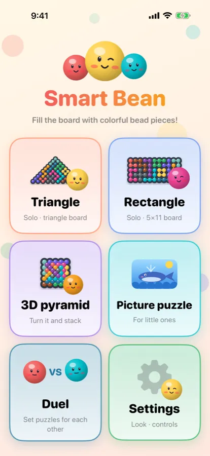
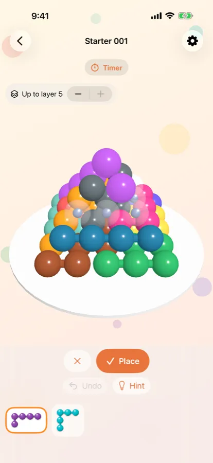
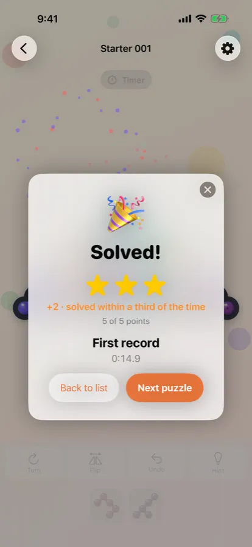
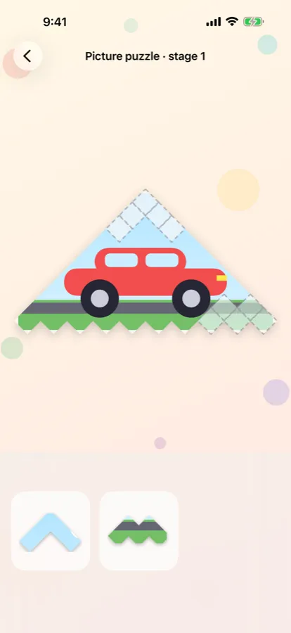

Twelve colorful bead pieces. Fifty-five holes.
Turn them, flip them, slide them in, until the last piece clicks into place. **Smart Bean** is a puzzle game made for that click.

### Three boards

- **Triangle** and **Rectangle**: drag a piece and it snaps into place like a magnet. Turn, flip, undo and hints are always at hand.
- **3D Pyramid**: stack 55 beads in five layers. Spin the pyramid with a finger and hide the upper layers to fill the inside.

Five levels from Starter to Expert, 50 puzzles each: **750 puzzles, every one with exactly one answer**.

### Stars and friends

Earn stars for every puzzle and bonus points for speed. Finish a level to get a **certificate**, with your selfie if you like. Along the way, **12 bead friends** in hats, headphones and crowns come to join you.

### Picture puzzles for little ones

Even children who can't read yet can play. Each piece carries part of a picture (a whale, a car, a watermelon, a rocket) and goes where the picture fits. A voice guides the way and nothing scolds a wrong move. Later stages teach turning, and in the end the picture becomes a real bead puzzle.

### Play together

- **Set puzzles**: one player builds a puzzle, the other solves it against the clock.
- **Race**: everyone gets the same random puzzle; the fastest wins. Pass one device around, or connect nearby devices for **up to 8 players** at once.

### Made with care

- Works on iPhone, iPad and Mac; your progress follows you with iCloud.
- In English and Korean.
- No ads, and no personal data collected.
- **Free** to download with Starter and Easy levels and picture puzzle stages 1–2; one purchase ($1.99) unlocks every level, shared with your family.

📱 App Store: coming soon
🔒 [Privacy Policy](/smartbean/privacy/) · 💬 [Support](/smartbean/support/)
