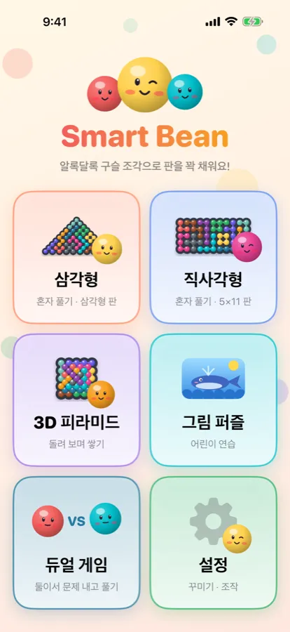
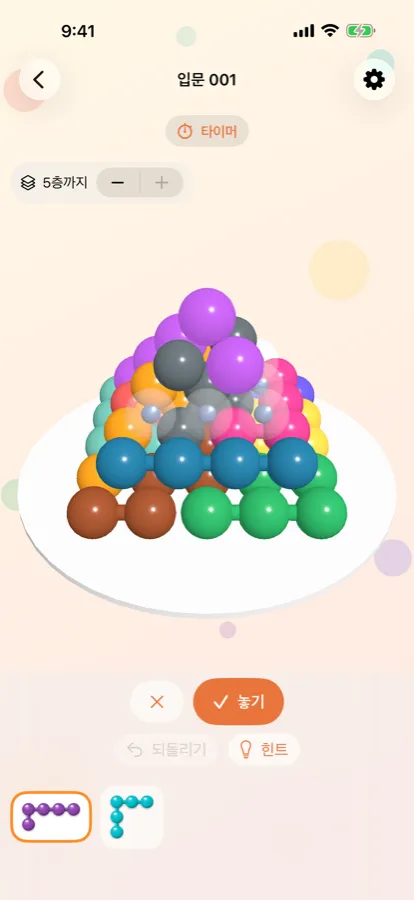
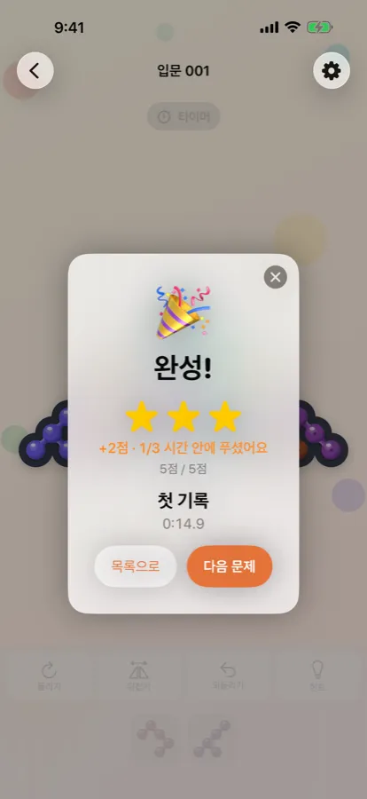
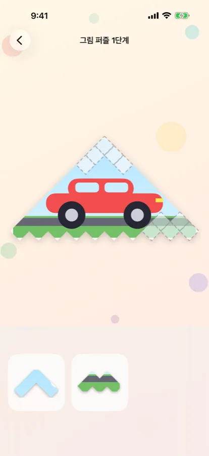

알록달록한 구슬 조각 열두 개. 빈칸은 쉰다섯 개.
조각을 돌리고 뒤집어 빈칸에 쏙 넣다 보면, 마지막 조각이 딱 맞아 들어가는 순간이 옵니다. **Smart Bean**은 그 "딱!" 하는 기쁨을 위한 퍼즐 게임입니다.

### 세 가지 판

- **삼각형**과 **직사각형**: 조각을 끌어다 놓으면 맞는 자리에 자석처럼 붙습니다. 돌리기·뒤집기·되돌리기·힌트가 있어요.
- **3D 피라미드**: 구슬 55개를 다섯 층으로 쌓습니다. 손가락으로 피라미드를 돌려 보고, 위층을 숨겨 안쪽까지 채웁니다.

판마다 입문부터 최상급까지 다섯 단계, 단계마다 50문제. 모두 **답이 하나뿐인 문제 750개**입니다.

### 별과 친구들

문제를 풀면 별을 받고, 빨리 풀면 보너스 점수가 붙습니다. 단계를 마치면 **인증서**를 받고 셀카도 함께 넣을 수 있어요. 문제를 풀어 갈수록 모자·헤드폰·왕관을 쓴 **구슬 친구 12명**이 하나씩 찾아옵니다.

### 어린이를 위한 그림 퍼즐

글을 아직 못 읽는 아이도 할 수 있습니다. 조각마다 고래·자동차·수박·로켓 그림의 한 조각이 그려져 있고, 그림이 맞는 자리에 끌어다 놓으면 됩니다. 목소리로 안내하고, 틀려도 혼내지 않습니다. 단계가 오를수록 돌리기를 배우고, 마지막에는 그림이 진짜 구슬 퍼즐로 바뀝니다.

### 함께 하는 듀얼

- **문제 내기**: 한 사람이 문제를 만들면 다른 사람이 제한 시간 안에 풉니다.
- **같은 문제로 시합**: 무작위로 뽑은 같은 문제를 누가 더 빨리 푸는지 겨룹니다. 한 기기에서 돌아가며, 또는 근처 기기끼리 **최대 8명**이 동시에 할 수 있어요.

### 이렇게 만들었습니다

- iPhone · iPad · Mac에서 모두 쓸 수 있고, 같은 Apple 계정이면 iCloud로 기록이 이어집니다.
- 한국어와 영어를 지원합니다.
- 광고가 없고, 개인 정보를 모으지 않습니다.
- **무료**로 받아 입문·쉬움 단계와 그림 퍼즐 1~2단계를 즐길 수 있고, 한 번 구매($1.99)로 모든 단계를 엽니다. 가족 공유도 됩니다.

📱 [App Store에서 받기](https://apps.apple.com/app/id6830463805) (iPhone · iPad · Mac)
🔒 [개인정보 처리방침](/smartbean/privacy/) · 💬 [문의하기](/smartbean/support/)
